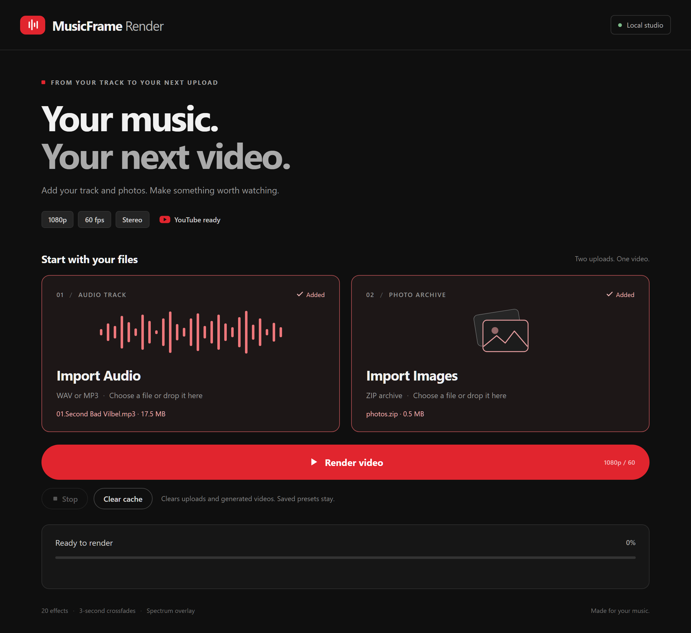

# MusicFrame Render

Transform music and photos into audio-reactive videos in just two clicks. MusicFrame Render runs locally, with a simple browser interface accessible across your LAN.

## Features

- **20 visual effects** spanning granular animation, glitch, CRT, particles, depth and photo rotation, with a transparent spectrum analyzer overlay.
- **Smooth sequencing:** 5 seconds per effect followed by a 3-second crossfade, repeating throughout the track.
- **Random image order:** a fresh shuffle for each render, with every image shown before the sequence repeats.
- **Balanced audio response** combining the original motion intensity with adaptive dynamics, including in heavily limited recordings.
- **Long-form rendering:** tracks up to 12 hours and ZIP archives containing up to 300 images, subject to available storage.
- **Hardware acceleration:** GPU rendering and optional NVIDIA NVENC encoding, with automatic CPU fallback. Frames stay synchronized regardless of processing speed.
- **Progress, time estimates, Stop and Clear cache**, plus server-side presets shared across browsers.

## Usage

See [Installation](INSTALLATION.md) and [Requirements](REQUIREMENTS.md) for setup.

Open **http://localhost:5180** or the LAN address printed at startup. Intended for a trusted private network; no authentication is provided.

1. **Import Audio** — WAV or MP3.
2. **Import Images** — ZIP containing JPG, JPEG, PNG or WebP files.
3. **Render** — follow progress and download the finished MP4.

Rendering continues when the browser closes; keep the server running. One render runs at a time. The optional preset studio is available at `/studio.html`.

## Output and storage

**1080p · 60 fps · H.264 High Profile · AAC stereo, 48 kHz / 384 kbit/s.** Output is optimized for high-quality uploads to YouTube. Software encoding uses CRF 18 with a 32 Mbit/s video peak limit. YouTube performs its own transcoding after upload.

Inputs and analysis are stored in `data/projects/`, videos and render recipes in `data/exports/`, and presets in `data/saved-settings.json`. Long tracks use streamed analysis. Allow space for the inputs and finished video; processing can take longer than playback.

**Clear cache** removes all working data while idle, including imports, analysis, projects, generated videos and render recipes. Your saved effect settings are preserved exactly. A confirmation is required; diagnostic logs are retained.

## Visual effect sources

The application combines original effects with targeted adaptations of these MIT-licensed projects. Full credits, license texts and adaptation details are preserved in [THIRD_PARTY_NOTICES.md](THIRD_PARTY_NOTICES.md) and the bundled sources.

| Source | Contribution |
| --- | --- |
| [Astrofox](https://github.com/astrofox-io/astrofox) — Mike Cao | Distortion, RGB separation, kaleidoscope and LED shaders, including WebGL Noise by Stefan Gustavson, Ian McEwan and Ashima Arts. |
| [Memory Signal](https://github.com/shuhari04/memory-signal-threejs) — shuhari04 | Photo sampling, brightness-based relief and particle foundations. |
| [Ditherer](https://github.com/gyng/ditherer) — Ng Guoyou and contributors | Dithering, pixel sorting, ASCII, CRT and related treatments. |
| [Fosfora](https://github.com/kevinraymond/fosfora) — Kevin Raymond | Particle morphing, cymatics, tiled reveals and window layouts. |
| [FFT Visualizer](https://github.com/harmonics-audio/fft-visualizer) — Wouter Vernaillen | Spectrum analyzer shader and gradients. |
| [Three.js](https://github.com/mrdoob/three.js) — Three.js authors; plexus example by Fernando Serrano | WebGL rendering and photo plexus foundations. |

## License

MusicFrame Render is released under the [MIT License](LICENSE), copyright © 2026 Sébastien Bédard. Third-party components retain their own licenses and copyright notices.

Conçu par Sébastien Bédard
